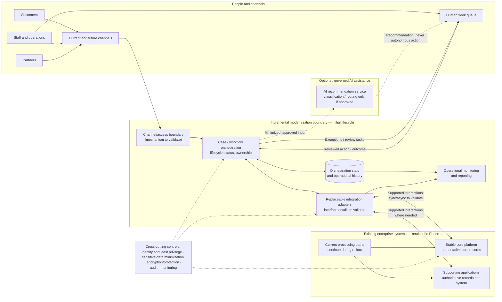

# D3. Target-state architecture

## Architecture view

**Diagram notes:** The modernization boundary is a conceptual capability boundary, not a prescribed deployment topology. Solid arrows show the intended interaction; dashed arrows are optional AI flows. The exact channel/access mechanism, core and application interfaces, and synchronous/asynchronous interaction patterns are to be validated. The current processing paths remain operational during phased adoption.

## Major components and responsibilities

| Component | Responsibility | Ownership / source-of-truth note |
|---|---|---|
| Channels and access boundary | Accept work from customers, staff, and partners and route in-scope work to the orchestration capability. | Channel ownership remains with the relevant channel systems; the access mechanism is not specified. |
| Case/workflow orchestration | Coordinate the agreed initial lifecycle, show in-scope status and accountable ownership, and route exceptions for review. | Owns orchestration state, not authoritative core business records. Lifecycle ownership and boundaries must be agreed. |
| Human work queue | Give authorized staff visibility of exceptions and a place to review, resolve, or approve work. | Human decisions and outcomes should be attributable and recorded; operational ownership is TBD. |
| Integration adapters | Isolate orchestration from system-specific interfaces and translate supported requests/responses or notifications. | Do not take ownership of source-system records. Core/application interface contracts are to validate. |
| Existing core platform | Continue its established business processing and retain its existing authoritative records. | Explicitly retained in Phase 1; not replaced by this design. |
| Supporting applications | Continue relevant business functions and retain the records they currently own. | Exact systems and record ownership are not supplied and must be confirmed. |
| Orchestration state and operational history | Persist the workflow's progress, status transitions, ownership, and review outcomes needed for the in-scope lifecycle and audit/operations view. | Separate from source-system records. Exact persistence design and retention are TBD. |
| Operational monitoring and reporting | Surface integration/workflow health and support agreed operational measures. | Reporting definitions, data sources, and owners are TBD. |
| Optional AI recommendation service | If approved, suggest classification or routing using minimized, permitted inputs. | Not a source of truth and not required for Phase 1. Recommendations require human review. |

## Integration and data

- Route new in-scope work through the orchestration boundary and adapters; integrate with the core and supporting applications using their **supported interfaces**, which have not yet been identified.
- Keep the existing core authoritative for its established records. Supporting applications remain authoritative for the records they own. The orchestrator maintains process state and a reference/status view; it does not silently replicate or supersede source records.
- Capture relevant workflow transitions, accountable actors, and human review outcomes in an operational history, subject to agreed audit and retention requirements. Keep integration and operational telemetry distinguishable from business records.
- Use synchronous calls, asynchronous notifications, or a mix only after interface and operational requirements are confirmed. Do not assume that the core exposes events or supports a particular protocol.
- Define identifiers, status mappings, duplicate handling, and reconciliation for systems that cannot provide a consistent real-time view. These are validation/design tasks, not facts established by the scenario.

## AI and human control

- Runtime AI is **optional** and not a Phase 1 dependency. If approved, limit its role to recommendations such as exception classification or routing.
- Minimize or redact sensitive information before any AI processing; use only an organization-approved service and approved data. The scenario does not establish that sensitive data can be sent to an AI service.
- Present recommendations to authorized staff for review. Staff own consequential decisions, overrides, and final actions; record the outcome for audit where required.
- Define confidence/uncertainty handling, escalation, review capacity, and monitoring before enabling the capability. If governance or permitted data use is not confirmed, omit the AI runtime flow.

## Security and resilience

- Enforce identity-based access and least privilege for channels, operators, integrations, and administrators; exact identity mechanisms are TBD.
- Protect sensitive information in transit and at rest, minimize collected/copied data, and apply approved retention and deletion rules; platform details require validation.
- Record attributable workflow actions and human decisions, and protect audit/operational history from unauthorized access or modification.
- Isolate integration failures from the existing processing path where possible. Define timeouts, retry/idempotency behavior, error visibility, and reconciliation against actual interface capabilities before rollout.
- Monitor workflow and integration health, failed/aged work, and operational outcomes. Alerting, availability objectives, recovery objectives, and capacity limits are not provided and must be agreed.
- Roll out incrementally with a tested coexistence and rollback approach so normal business processing continues; detailed cutover controls belong in delivery planning.

## Design assumptions and validation points

- Validate that the core and required supporting applications expose interfaces usable for the initial lifecycle, and confirm their constraints and owners.
- Agree the initial lifecycle, business process owner, source-of-truth boundaries, status vocabulary, and work-item identifiers.
- Confirm the first usable scope and how new orchestration will coexist with current processing without interrupting it.
- Establish volume/peak patterns, service expectations, and recovery requirements before sizing or making resilience claims.
- Confirm audit/retention requirements, security controls, approved AI policy, and human-review ownership.
- Treat the diagram as a target capability view; infrastructure, products, protocols, storage, and deployment topology remain unspecified.

## Alignment to D2

This view implements D2's conditional preference for workflow-led case orchestration around the existing core, with replaceable adapters and a narrowly scoped initial lifecycle. It preserves core and supporting-system record ownership, supports phased coexistence, and routes exceptions through human review. The integration and business ownership dependencies remain explicit; optional AI is governed and cannot make autonomous consequential decisions.
