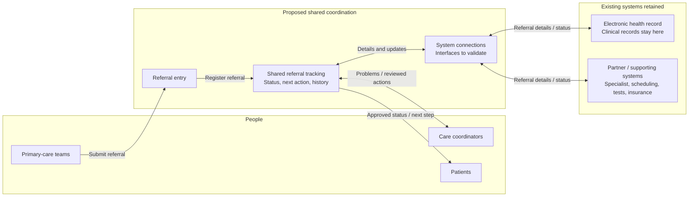

### D3. Target-state architecture

#### Architecture view

Care teams submit referrals; shared tracking exchanges updates with existing systems, directs problems to coordinators, and provides approved patient updates.

**Across all flows:** necessary data only, authorized access, traceable actions, monitoring, and safe recovery. These are proposed controls, not implemented guarantees.

#### Major components and responsibilities
| Component | Responsibility | Record ownership |
|---|---|---|
| Referral entry | Receive referrals within the selected scope. | Does not replace clinical records. |
| Shared referral tracking | Show progress, who acts next, follow-up tasks, and action history. | Holds coordination data, not the official clinical record. |
| System connections | Exchange permitted referral details and updates; isolate system-specific changes. | Connected systems retain their records. |
| Existing EHR | Continue clinical documentation and existing care processes. | Remains authoritative for its clinical records. |
| Partner / supporting systems | Continue specialist, scheduling, diagnostic, and insurance workflows. | Each retains its existing record responsibilities; confirm boundaries. |

#### Integration and data
- Exchange uses supported interfaces; standards, mappings, identity matching, and partner participation need validation. Specialist teams act through their existing systems/channels; exact channels need confirmation.
- Store only necessary identifiers, progress, next-action responsibility, and history. Receipt, scheduling, and completed care are separate milestones; absent updates never mean completion.

#### AI and human control
AI is optional and outside the core diagram. Any later use requires approved inputs and human review; no autonomous clinical decisions. Coordinators resolve administrative problems and escalate clinical concerns to authorized clinicians. Patients must have a route to human help.

#### Security and resilience
- Confirm access roles, consent, retention, and protection of patient information in storage and exchange.
- Record attributable actions; monitor delayed referrals and failed connections using minimum necessary data.
- Give failures a responsible person and agreed fallback. Validate duplicate handling, safe retry, conflicting updates, and recovery before pilot; normal care must continue.

#### Design assumptions and validation points
- Clinical and operational owners must select the first referral process and confirm responsibilities; approval is not yet recorded.
- Technical and partner teams must verify interfaces, identifiers, status meanings, and data boundaries.
- Privacy/security owners must confirm controls and patient communication rules.
- Validate expected volume, recovery needs, and feasible scope against the approximately 12-week initial capability expectation; capacity and resilience are unproven.

#### Alignment to D2
This implements D2's conditional Option A around the retained EHR. Shared tracking and follow-up tasks support D1's rework, turnaround, visibility, hand-off, and action-record measures; improvement must be measured, not assumed.
